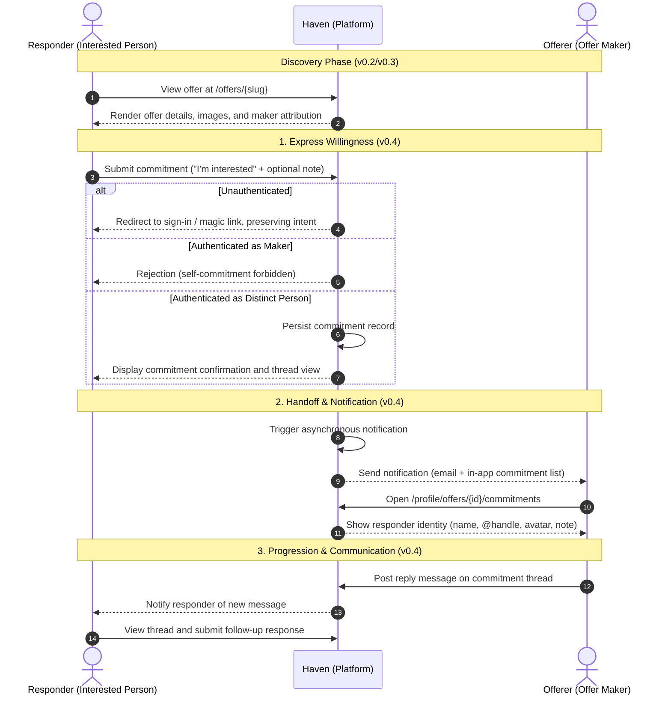

# v0.4.x Untangling and Planning: Commitment & Communication

This document untangles the product roadmap items for **v0.4.x ("Can someone act on it?")** into their constituent sub-journeys, states, and edge conditions, following the [`haven-journey`](../expts/rust/.agents/skills/haven-journey/SKILL.md) and [`haven-product`](../expts/rust/.agents/skills/haven-product/SKILL.md) guidelines.

---

## 1. Roadmap Stage Alignment

- **Stage**: `0.4.x — Can someone act on it?`
- **Core Question**:
  > *Can someone do something meaningful about an offer?*
- **Done When**:
  > *An offer can receive a meaningful response from another person, and the system meets its load-testing performance contract.*
- **Checkboxes from `ROADMAP.md`**:
  - [ ] A person can express their willingness to take on an offer.
  - [ ] The person who made the offer can know about that expression of interest, and who it came from.
  - [ ] People can communicate when communication is necessary to understand or progress that commitment.

---

## 2. The Journey: Two Lanes, One Story



---

## 3. Untangled Sub-Journeys

### Sub-Journey 1: Express Willingness to Take on an Offer (Responder Lane)
- **Goal**: A person encountering an offer wants to express clear intent to fulfill or claim it.
- **Preconditions**:
  - Offer must be public and available.
  - Person must be signed in (if guest, auth flow preserves return destination).
- **Steps**:
  1. Person visits `/offers/{slug}`.
  2. Action area displays a primary interaction affordance: **"Express Interest"** or **"Commit to Offer"**.
  3. Clicking opens an intent modal / inline form prompting for an optional opening message (e.g., questions on availability, proposed schedule, or clarification).
  4. Form submits via `POST /offers/{slug}/commit`.
  5. Upon success, responder is redirected to `/commitments/{id}` (or an inline confirmation state on `/offers/{slug}`).
- **Edge Conditions & Invariants**:
  - **Self-Commitment**: A maker cannot express interest in their own offer (domain validation + UI suppression).
  - **Duplicate Commitment**: A responder who has already committed cannot submit duplicate commitments (idempotent redirect to existing thread).
  - **Offer Deletion Race**: If the maker deletes the offer concurrently, submission fails gracefully with an honest 404/gone notice.

---

### Sub-Journey 2: Offerer Discovers Expression of Interest (Offerer Lane & Handoff)
- **Goal**: The maker learns that someone responded, discovers their identity, and assesses the response.
- **Handoff Event**: Occurs atomically upon commitment creation.
- **Steps**:
  1. Offerer is alerted through two coordinated channels:
     - **In-App**: On `/profile` dashboard and `/profile/offers/{id}`, an inquiries badge and list show incoming commitments.
     - **Email**: Transactional email sent to offerer (`"[Haven] New interest in your offer: <Title>"`).
  2. Offerer visits the commitment management view (`/profile/offers/{id}/commitments` or `/commitments/{id}`).
  3. The maker sees the responder's full public identity:
     - Display name and verified `@handle`
     - Profile avatar (with fallback initials)
     - Optional bio / public profile link
     - Initial note / timestamp of commitment
- **Edge Conditions & Invariants**:
  - **Multiple Responders**: If three people express interest, all three are listed chronologically without leaking responders' private details to each other.
  - **Empty State**: An offer with zero responses displays a calm empty state: *"No one has expressed interest yet."*

---

### Sub-Journey 3: Progressing Commitment via Communication (Both Lanes)
- **Goal**: Both parties can clarify terms, timeline, or requirements to determine whether they will close the offer.
- **Steps**:
  1. Either party navigates to the shared thread at `/commitments/{id}`.
  2. The page renders:
     - Context header: Offer summary (title, price, cover photo, link to public slug).
     - Identity cards for both participants (Offerer and Responder).
     - Chronological list of message bubbles attributed by sender name and relative timestamp.
     - Fast server-rendered `POST /commitments/{id}/messages` input form.
  3. Submitting appends the message and refreshes the view.
- **Edge Conditions & Invariants**:
  - **Strict IDOR Protection**: Only the specific Offerer and the specific Responder may view or post to `/commitments/{id}`. Any other user receives an indistinguishable 404.
  - **Validation**: Blank messages or messages exceeding length limits (e.g., 2,000 characters) are rejected with clear inline errors.
  - **Zero-JS Resilience**: Entire flow functions seamlessly with standard HTML form `POST` and redirects, compatible with Topcoat server-rendering.

---

## 4. Product Decisions Requiring User Input

The roadmap states: *"What exactly that commitment means, and what should happen after it, will be discovered and defined during this version."* The following four decisions shape the architecture:

| # | Decision Topic | Option A (Recommended) | Option B (Alternative) | Trade-Off Rationale |
|---|---|---|---|---|
| **1** | **Offer Capacity & Concurrency** | **Multi-Interest Pool**: Offer stays open; multiple responders can express interest. Maker chooses who to proceed with. | **Exclusive Lock**: First commitment reserves/locks the offer, hiding it from other responders. | Option A fits real-world matching (someone may flake; maker needs options before closing). Exclusive lock belongs to 1.0.x agreement. |
| **2** | **Commitment Payload** | **Single Click + Optional Note**: Button opens lightweight textarea for optional note. | **Strict Button Only**: Instant click with no text input. | An optional note allows the responder to specify timeline or questions immediately without forcing a two-step messaging overhead. |
| **3** | **Notification Mechanism** | **Dual Notification**: In-app inbox / profile list + transactional email notification. | **In-App Only**: No emails; users must log in to see updates. | Dual notification prevents missed commitments on low-frequency platforms while maintaining calm, unhurried interactions. |
| **4** | **Communication Format** | **Server-Rendered Thread**: Chronological text exchange scoped to `(offer, responder)` within Haven. | **Contact Reveal**: Reveal email / phone number directly and exit platform. | A lightweight server-rendered thread protects personal contact details, preserves platform trust, and maintains context for 1.0.x closing. |

---

## 5. Proposed Domain & Data Architecture

### Domain Entities (`haven-domain`)

```rust
/// Current lifecycle state of an expression of interest.
#[derive(Debug, Clone, Copy, PartialEq, Eq, Serialize, Deserialize)]
pub enum CommitmentStatus {
    /// Initial active expression of interest.
    Pending,
    /// Offerer has agreed to progress with this responder.
    Accepted,
    /// Offerer has chosen not to proceed with this responder.
    Declined,
    /// Responder withdrew their expression of interest.
    Withdrawn,
}

/// A person's expression of willingness to take on an offer.
#[derive(Debug, Clone, PartialEq, Eq)]
pub struct Commitment {
    pub id: Uuid,
    pub offer_id: Uuid,
    pub responder_id: Uuid,
    pub status: CommitmentStatus,
    pub initial_note: Option<String>,
    pub created_at: DateTime<Utc>,
    pub updated_at: DateTime<Utc>,
}

/// A message exchanged within a commitment thread.
#[derive(Debug, Clone, PartialEq, Eq)]
pub struct CommitmentMessage {
    pub id: Uuid,
    pub commitment_id: Uuid,
    pub sender_id: Uuid,
    pub body: String,
    pub created_at: DateTime<Utc>,
}
```

### Relational Schema (`migrations/014_commitments_and_messages.sql`)

```sql
-- 1. Commitments table
CREATE TABLE commitment (
    id UUID PRIMARY KEY DEFAULT gen_random_uuid(),
    offer_id UUID NOT NULL REFERENCES offer(id) ON DELETE CASCADE,
    responder_id UUID NOT NULL REFERENCES "user"(id) ON DELETE CASCADE,
    status VARCHAR(20) NOT NULL DEFAULT 'pending',
    initial_note TEXT,
    created_at TIMESTAMPTZ NOT NULL DEFAULT NOW(),
    updated_at TIMESTAMPTZ NOT NULL DEFAULT NOW(),
    -- Enforce at most one active commitment per responder per offer
    CONSTRAINT uq_commitment_offer_responder UNIQUE (offer_id, responder_id)
);

CREATE INDEX idx_commitment_offer ON commitment(offer_id, created_at DESC);
CREATE INDEX idx_commitment_responder ON commitment(responder_id, created_at DESC);

-- 2. Commitment messages table
CREATE TABLE commitment_message (
    id UUID PRIMARY KEY DEFAULT gen_random_uuid(),
    commitment_id UUID NOT NULL REFERENCES commitment(id) ON DELETE CASCADE,
    sender_id UUID NOT NULL REFERENCES "user"(id) ON DELETE CASCADE,
    body VARCHAR(2000) NOT NULL,
    created_at TIMESTAMPTZ NOT NULL DEFAULT NOW()
);

CREATE INDEX idx_commitment_message_thread ON commitment_message(commitment_id, created_at ASC);
```

---

## 6. Implementation Phases

```
┌─────────────────────────────────────────────────────────────┐
│ Phase 1: Domain Contracts & Ports (haven-domain)            │
│ - Add Commitment, CommitmentStatus, CommitmentMessage       │
│ - Define CommitmentRepository port trait and mock fakes     │
└──────────────────────────────┬──────────────────────────────┘
                               │
┌──────────────────────────────▼──────────────────────────────┐
│ Phase 2: Schema Migration & Persistence (haven-db)          │
│ - Migration 014: commitment & commitment_message tables     │
│ - SQL queries: create, list_by_offer, find_by_parties       │
│ - Append message query and hermetic sqlx::test coverage     │
└──────────────────────────────┬──────────────────────────────┘
                               │
┌──────────────────────────────▼──────────────────────────────┐
│ Phase 3: Delivery Handlers & Route Authorization (haven-web)│
│ - POST /offers/{slug}/commit (intent creation)              │
│ - GET /commitments/{id} (conversation thread view)          │
│ - POST /commitments/{id}/messages (message submission)      │
│ - GET /profile/commitments (responder's active inquiries)   │
│ - Strict IDOR authorization checks on all commitment routes │
└──────────────────────────────┬──────────────────────────────┘
                               │
┌──────────────────────────────▼──────────────────────────────┐
│ Phase 4: Server-Rendered UI Views & Tokens (haven-web)       │
│ - "Express Interest" action component on public offer slug  │
│ - Commitment status badge and message thread template       │
│ - Owner notification indicator in /profile shell            │
│ - Editorial layout adhering to haven-ui-design tokens       │
└──────────────────────────────┬──────────────────────────────┘
                               │
┌──────────────────────────────▼──────────────────────────────┐
│ Phase 5: Verification, Load Testing & Security Audit        │
│ - k6 commitment and message load scenario                   │
│ - rust-security-review: verify zero IDOR / CSRF / leaks     │
│ - Full test suite verification across workspace             │
└─────────────────────────────────────────────────────────────┘
```

---

## 7. Explicit Scope Boundaries

### In Scope for v0.4.x:
- Responders expressing willingness on public offers.
- Offerers discovering who expressed interest with complete attribution.
- Two-party messaging thread strictly between Offerer and Responder.
- Email and in-app alerts on new commitments.
- Keyset-paginated message threads and commitment lists.

### Explicitly Deferred to Future Versions:
- **v0.5.x**: Search by offer name or filter by price.
- **v0.6.x**: Saving offers or following makers.
- **v0.7.x**: Category and tag filters.
- **v1.0.x**: Formal agreement, escrow/holding, contract generation, and closing.
- **2.0.x**: Payment processing, dispute arbitration, and fulfillment tracking.
