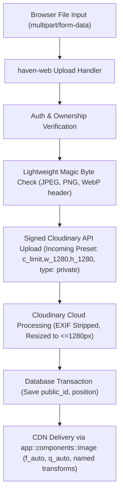

# Image Integration Architecture and Implementation Plan (Cloudinary & SSR)

This document outlines the architectural blueprint, security model, schema design, and staged implementation roadmap for integrating images into Haven for **both Offers and Profiles** in unified release **v0.3.5**, adhering to the recorded owner decisions and constraints in `haven-ui-images`.

---

## 1. Architectural Principles & Free-Tier Budget Defense

Haven is hosted on a resource-constrained server (Koyeb free tier: 0.1 vCPU, 512 MB RAM). To guarantee that image processing never starves the CPU or triggers Out-Of-Memory (OOM) kills, **haven-web does not decode or re-encode image pixels**. 

Instead:
1. `haven-web` acts as an authenticated security gate (validates magic bytes, checks session ownership, and rate limits).
2. `haven-web` dispatches the payload to Cloudinary using a **Signed Upload Preset with an Incoming Transformation**.
3. Cloudinary executes the downsampling, EXIF stripping, and WebP/AVIF compression in the cloud.
4. Images are delivered via Cloudinary's global CDN using `f_auto,q_auto` for progressive format negotiation (WebP/AVIF for modern clients, automatic JPEG fallback for legacy devices).

### Free-Tier Budget Defense (25 Monthly Credits)
Cloudinary defines 1 credit as:
- **1 GB storage**, or
- **1 GB net viewing bandwidth**, or
- **1,000 transformations**.

Haven consumes **strictly image bytes (0 bytes for video and raw assets)**. To maximize efficiency under the 25 credit allocation:
- **Cloudinary Incoming Transformation (`c_limit,w_1280,h_1280`):** Re-scales any large 10–15 MB camera original down to a maximum bounding box of 1280px on upload before saving. The multi-megabyte raw original is discarded, storing only ~100–200 KB per asset (1 GB comfortably stores 5,000–10,000 images).
- **Automatic Multi-Format Delivery (`f_auto, q_auto`):** Deliver via `f_auto,q_auto` on named transformations. Cloudinary inspects the browser `Accept` header to deliver AVIF/WebP to modern browsers and transparent JPEG fallback to legacy devices without multiplying code complexity or breaking on older hardware.
- **Named Transformations Only:** Strict transform mode in Cloudinary utilizing 4 standard variants with 1x and 2x resolutions:
  - `avatar`: $96\times96$, $192\times192$ (1:1 aspect ratio)
  - `thumb`: $120\times90$, $240\times180$ (4:3 aspect ratio)
  - `card`: $320\times240$, $640\times480$ (4:3 aspect ratio)
  - `detail`: $640\times480$, $960\times720$ (4:3 aspect ratio)
- **Lazy Derived Generation:** Generate variant sizes on first read rather than eagerly creating all sizes during upload.
- **Immutable Public IDs:** New random UUIDs per upload (`offers/{offer_id}/{uuid}`, `users/{user_id}/{uuid}`); never overwrite public IDs in place.

---

## 2. Security & Processing Pipeline



### Security Gates
1. **No SVG Support:** Strictly allow JPEG, PNG, and WebP. SVG is disallowed due to embedded script execution risks.
2. **Server-Side Validation:** Check magic bytes directly on the first 16 bytes; never trust client-supplied `Content-Type` headers or file extensions.
3. **Metadata Stripping & Auto-Orientation:** Cloudinary strips EXIF location (GPS) and camera metadata automatically during ingestion while applying orientation so photos display upright.
4. **Private Asset Type:** Cloudinary assets uploaded with `type: private` and Strict Transformations enabled so raw original binaries cannot be accessed directly.
5. **Rate Limiting & Size Caps:** Strict file size caps (e.g. 5 MB) and rate-limited multipart upload endpoints.
6. **Storage Leak Prevention:** Delete Cloudinary assets asynchronously or via background job when an offer image or avatar is replaced or deleted.

---

## 3. Product Rules & Visibility

Both Offer photos and Profile avatar are delivered together in v0.3.5:

1. **Offers:**
   - Minimum 1, maximum 5 images per offer.
   - **Visibility Rule:** An offer without at least 1 image is **not public**. It is hidden from `/offers` feeds, search, and returns HTTP 404 on `/offers/{slug}`.
   - Owner experience: On `/profile/offers/{id}`, non-public offers display an explicit calm banner: *"Only you can see this offer. Add a photo to make it public."*
   - Cover image: Position 1 image automatically serves as the cover image for cards and lists.
   - Alt text: The offer title serves as alt text.
2. **Profiles:**
   - Profile avatar is optional (at most 1 image).
   - When no image is present, render the existing neutral initial placeholder. Block layout remains pixel-identical.

---

## 4. Navigation Architecture & Safe Back Rules

To prevent navigation loops (e.g. between `/profile/offers/{id}` and `/offers/{slug}`):
- Child routes never show the primary navigation on mobile; they display a back button header.
- On `/offers/{slug}`, navigating from `/profile/offers/{id}` sets the back button to `/profile/offers/{id}`.
- On `/profile/offers/{id}`, any Referer from `/offers/...` or `/profiles/...` is strictly rejected by `should_reject_referer`, ensuring the Back button ascends to the parent `/profile/offers`.
- On `/profile/offers`, ascending from `/profile/offers/{id}` ascends to `/profile`.

---

## 5. Database Schema Design (Migration 012)

```sql
-- Migration 012: Image support for offers and user profiles

-- 1. Profile avatar on user table
ALTER TABLE "user"
    ADD COLUMN avatar_public_id VARCHAR(120);

-- 2. Offer images table (enforcing 1-5 images per offer and position order)
CREATE TABLE offer_image (
    id UUID PRIMARY KEY DEFAULT gen_random_uuid(),
    offer_id UUID NOT NULL REFERENCES offer(id) ON DELETE CASCADE,
    public_id VARCHAR(120) NOT NULL,
    position SMALLINT NOT NULL CHECK (position >= 1 AND position <= 5),
    width INTEGER NOT NULL,
    height INTEGER NOT NULL,
    created_at TIMESTAMPTZ NOT NULL DEFAULT NOW(),
    CONSTRAINT uq_offer_image_position UNIQUE (offer_id, position),
    CONSTRAINT uq_offer_image_public_id UNIQUE (public_id)
);

CREATE INDEX idx_offer_image_offer_pos ON offer_image (offer_id, position);

-- 3. Offer image count cache / visibility flag on offer table for O(1) feed queries
ALTER TABLE offer
    ADD COLUMN image_count SMALLINT NOT NULL DEFAULT 0;

-- Index for public feed filtering (only show offers with image_count >= 1)
CREATE INDEX idx_offer_feed_visible ON offer (created_at DESC, id DESC)
    WHERE image_count >= 1;
```

---

## 6. Implementation Phases

### Phase 1: Foundations & Infrastructure
- [x] Add Cloudinary configuration environment variables (`CLOUDINARY_CLOUD_NAME`, `CLOUDINARY_API_KEY`, `CLOUDINARY_API_SECRET`, `CLOUDINARY_UPLOAD_PRESET`).
- [x] Implement zero-dependency magic byte validation (`validate_image_magic_bytes`) checking first 16 bytes for JPEG, PNG, and WebP signatures.
- [x] Define decoupled `ImageStorage` trait (`upload`, `delete`) and `CloudinaryStorage` adapter using signed upload preset with incoming transformations (`c_limit,w_1280,h_1280`).
- [x] Provide `MockImageStorage` implementation for unit tests and local development without cloud dependencies.
- [x] Run Migration `012_images.sql` across development and CI databases.

### Phase 2: Domain Models & Repositories
- [x] Define `ImageId`, `ImagePublicId`, `ImagePosition` (1..=5), and `ImageDimensions` value objects in `haven-domain`.
- [x] Update `Offer` entity with image list and visibility status (`is_public = image_count >= 1`).
- [x] Add `OfferImageRepository` methods in `haven-db` (`add_image`, `remove_image`, `reorder_images`).
- [x] Update public feed query (`list_active`) to filter on `image_count >= 1`.

### Phase 3: Profile Avatar Integration
- [x] Add avatar upload affordance to `/profile/edit`.
- [x] Build `app::components::image` URL helper with named transformations (`avatar`, `thumb`, `card`, `detail`).
- [x] Render avatar in `IdentityBlock` when `avatar_public_id` is present; fall back cleanly to initial placeholder.

### Phase 4: Offer Images & Management UI
- [ ] Add image upload dropzone / input to `/profile/offers/new` and `/profile/offers/{id}`.
- [ ] Implement image deletion and reordering on `/profile/offers/{id}`.
- [ ] Update `offer_card` to render 4:3 cover thumbnail in the leading slot.
- [ ] Update `/offers/{slug}` public detail view to render the photo stack with proper alt text (`"Title, photo N of M"`).

### Phase 5: Verification, Load Testing & Hardening
- [ ] Unit and integration tests for upload validations, magic byte detection, SVG rejection, and EXIF stripping.
- [ ] Integration tests verifying offer visibility rules (hidden from feed and 404 on slug route when `image_count == 0`).
- [ ] k6 steady-state verification confirming image uploads do not degrade core 1,000 RPS SLA.
